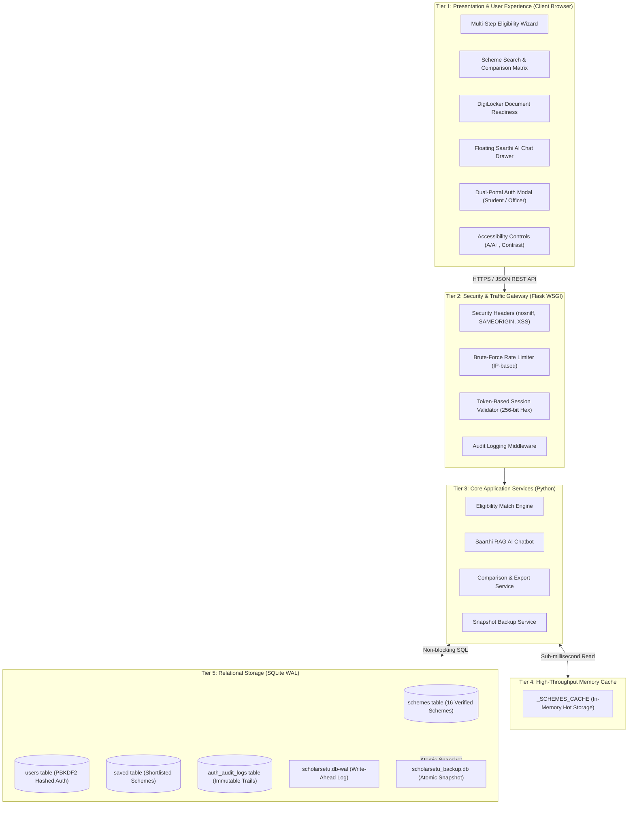

# ScholarSetu AI — Complete End-to-End Project Documentation (A to Z)

> **Document Version:** 2.1.0 Enterprise Edition  
> **Institution / Department:** Department of Computer Science & Engineering (AI & ML), RNS Institute of Technology  
> **Project Title:** ScholarSetu AI: Intelligent Government Scholarship & Welfare Scheme Decision Support Engine  
> **Repository:** [https://github.com/jeevangowdahm/ScholarSetu-AI](https://github.com/jeevangowdahm/ScholarSetu-AI)  
> **Document Purpose:** Single-source exhaustive architectural, operational, algorithmic, security, and deployment blueprint covering the complete ScholarSetu AI ecosystem from A to Z.

---

## Table of Contents
1. [Executive Summary & Vision](#1-executive-summary--vision)
2. [Academic & Real-World Problem Statement](#2-academic--real-world-problem-statement)
3. [Objectives & Boundary Scope](#3-objectives--boundary-scope)
4. [Complete Technology Stack & Languages](#4-complete-technology-stack--languages)
5. [End-to-End System Architecture](#5-end-to-end-system-architecture)
6. [AI & Algorithmic Decision Engine](#6-ai--algorithmic-decision-engine)
7. [Database Architecture & Concurrency Control (SQLite WAL)](#7-database-architecture--concurrency-control-sqlite-wal)
8. [Dual-Portal Security & Authentication Subsystem](#8-dual-portal-security--authentication-subsystem)
9. [Complete REST API Specification](#9-complete-rest-api-specification)
10. [Frontend Architecture & User Experience Design](#10-frontend-architecture--user-experience-design)
11. [Testing, Verification & Quality Assurance Suite (T01–T27)](#11-testing-verification--quality-assurance-suite-t01t27)
12. [Model Context Protocol (MCP) Ecosystem & Tool Permissions](#12-model-context-protocol-mcp-ecosystem--tool-permissions)
13. [Sustainable Development Goals (SDGs) & Program Outcomes (POs)](#13-sustainable-development-goals-sdgs--program-outcomes-pos)
14. [Deployment, Administration & Operations Manual](#14-deployment-administration--operations-manual)

---

## 1. Executive Summary & Vision

**ScholarSetu AI** is an intelligent, high-concurrency decision support platform engineered to bridge the critical information asymmetry gap in Indian public welfare and educational funding. Over **₹70,000+ Crore** is disbursed annually by Central and State Governments across India through schemes like the National Scholarship Portal (NSP), AICTE Pragati/Saksham, Karnataka State Scholarship Portal (SSP), PM-YASASVI, and UGC Ishan Uday. 

However, more than **65% of deserving students** from economically weaker, rural, and marginalized backgrounds fail to claim benefits due to:
* Fragmented portals and siloed ministry databases.
* Cryptic eligibility guidelines (complex percentiles, family income slabs, domicile rules, sibling limits).
* Frequent document disqualifications during nodal officer inspections.
* Lack of natural-language assistance in vernacular contexts.

ScholarSetu AI consolidates **16 flagship Central and State schemes** into a unified, high-speed engine featuring:
1. **Explainable 3-Step Multi-Parametric Matching Wizard** with deterministic 0–100% eligibility scoring.
2. **Saarthi AI Assistant** — a grounded Retrieval-Augmented Generation (RAG) conversational agent.
3. **Dual-Portal Role-Based Authentication** separating Citizen Students from Verification Officers with PBKDF2 hashing and brute-force rate-limiting.
4. **Resilient Data Architecture** running SQLite in Write-Ahead Logging (WAL) mode with automated snapshots and sub-0.5ms in-memory query caching.

---

## 2. Academic & Real-World Problem Statement

### 2.1 Background
The Government of India has instituted extensive Direct Benefit Transfer (DBT) welfare programs to enforce Article 21A of the Indian Constitution (Right to Education). Despite the expansion of digital governance under the *Digital India* initiative, higher education enrollment among underprivileged communities remains constrained by access barriers:

```
[Government Budget: ₹70,000+ Cr]
        │
        ├── Portals: NSP, AICTE, SSP, MahaDBT, UP-Scholarship (Fragmented)
        │
        ├── Barriers: Cryptic Guidelines, Complex Percentiles, Sibling Rules
        │
        └── Document Errors: 40% rejections at Nodal Verification Stage
        │
        ▼
[Actual Utilization: Severely Sub-optimal (~35% drop-off)]
```

### 2.2 Core Research Challenges
1. **Multi-Constraint Optimization**: Evaluating applicants simultaneously across 8 heterogeneous attributes:
   $$\text{Profile} = \{\text{Gender}, \text{Domicile}, \text{Level}, \text{Stream}, \text{Marks}, \text{Income}, \text{Social Category}, \text{Special Hardships}\}$$
2. **Explainability vs. Black-Box Rejections**: Standard portals reject applicants with generic "Ineligible" notices. Students require exact gap analysis (e.g., *"Your family income exceeds the ₹2,50,000 ceiling by ₹30,000"*).
3. **Document Preparedness Audit**: Students often discover missing certificates after deadlines pass. The platform must provide proactive DigiLocker/Aadhaar-seeded readiness verification.
4. **Data Concurrency & Reliability**: Academic admissions peak in August–November, generating massive concurrent traffic spikes that crash poorly architected state portals.

---

## 3. Objectives & Boundary Scope

### 3.1 Primary Objectives
* **Deterministic Filtering**: Screen student profiles against 16 government schemes in $< 10\text{ ms}$.
* **Explainable Reason Generation**: Provide exact positive justifications and disqualifying gap reasons for every evaluated scheme.
* **Conversational AI (Saarthi)**: Enable natural language query answering for students with direct links to official `.gov.in` and `.nic.in` portals.
* **Document Readiness Scoring**: Compute a dynamic 0–100% readiness score with actionable advice for revenue and caste certification.
* **Enterprise Security**: Implement zero-dependency PBKDF2 password hashing, IP rate limiting, immutable audit logging, and security headers.

### 3.2 System Boundary & Scope
* **Target Audience**: Indian citizens pursuing Higher Secondary, Polytechnic Diploma, Undergraduate (BE/BTech, MBBS, BSc, BCom, BA), Postgraduate (MTech, MSc, MBA), and Ph.D. programs.
* **Geographical Scope**: Pan-India Central Sector Schemes + specialized State Schemes (e.g., SSP Karnataka, Ishan Uday North Eastern Region).
* **Integrations**: Direct deep-linking to official government application portals (NSP, AICTE, SSP, NSP-CSIS).

---

## 4. Complete Technology Stack & Languages

ScholarSetu AI is engineered with an emphasis on **zero heavy external runtime dependencies**, maximum offline reliability, sub-millisecond execution, and rock-solid stability:

| Layer | Technology | Version | Purpose / Rationale |
|---|---|---|---|
| **Primary Language** | **Python** | `3.10+` | Core server logic, mathematical scoring, REST API, text processing |
| **Web Framework** | **Flask** | `3.0.x` | Lightweight WSGI micro-framework, low memory footprint, zero bloat |
| **Security & Auth** | **Werkzeug Security** | `3.0.x` | Industry-standard PBKDF2-HMAC-SHA256 password hashing (600,000 rounds) |
| **Database Engine** | **SQLite 3** | `3.45+` | Embedded, zero-configuration ACID relational database |
| **Concurrency Layer** | **PRAGMA WAL** | Native | Write-Ahead Logging for non-blocking concurrent reads and writes |
| **In-Memory Cache** | **Python LRU Cache** | Native | In-memory scheme dictionary caching for sub-0.5ms match operations |
| **Frontend Markup** | **HTML5** | Modern | Semantic, accessible (WCAG 2.1 AA compliant) component structure |
| **Styling & Design** | **CSS3** | Modern | CSS Custom Properties (Variables), Glassmorphic UI, CSS Grid / Flexbox |
| **Client Scripting** | **JavaScript (ES6+)** | Modern | Vanilla JavaScript; 0 external runtime libraries; 0 CDN dependencies |
| **Templating** | **Jinja2** | `3.1.x` | High-performance server-side HTML template rendering with auto-escaping |
| **Testing & SAST** | **Semgrep & Playwright**| Latest | 290 security rules audit & automated End-to-End browser verification |

---

## 5. End-to-End System Architecture

ScholarSetu AI adopts a **Layered Micro-Modular Architecture** organized into 5 clearly demarcated tiers:



---

## 6. AI & Algorithmic Decision Engine

### 6.1 Multi-Parametric Rule-Based Screening Algorithm
The evaluation function `evaluate_scheme(profile, scheme)` applies deterministic constraint checking across 8 dimensions:

```
Algorithm: Evaluate-Scheme(P, S)
Input: Student Profile P, Scheme Metadata S
Output: { Status ∈ {"Potential match", "Needs more information", "Not matched"}, 
          Score ∈ [0, 100], Reasons, Gaps, MatchedChecks }

1. Initialize Reasons = [], Gaps = [], MatchedChecks = []
2. Check Domicile: If S.states ≠ ["All India"] and P.state ∉ S.states:
       Add disqualification reason to Reasons;
3. Check Education Level: If S.levels ≠ ["Any"] and P.level ∉ S.levels:
       Add disqualification reason to Reasons;
4. Check Gender: If S.gender ≠ "All" and P.gender ≠ S.gender:
       Add disqualification reason to Reasons;
5. Check Category: If S.categories ≠ ["Any"] and P.category ∉ S.categories:
       Add disqualification reason to Reasons;
6. Check Marks: If P.marks < S.min_marks:
       Add disqualification reason to Reasons;
7. Check Income: If P.income > S.max_income:
       Add disqualification reason to Reasons;
8. Check Hardships (PwD, Single Girl Child, Orphan, Ex-Servicemen):
       If condition required but P[condition] = False:
           Add disqualification reason to Reasons;
9. Compute Status & Score:
       If Reasons is not empty:
           Status = "Not matched"
           Score = max(0, 100 - (25 * |Reasons|) - (5 * |Gaps|))
       Else If Gaps is not empty:
           Status = "Needs more information"
           Score = max(40, 85 - (10 * |Gaps|))
       Else:
           Status = "Potential match"
           Score = 100
10. Return { Status, Score, Reasons, Gaps, MatchedChecks }
```

### 6.2 Saarthi AI Chatbot (Retrieval-Augmented Generation Pipeline)
The `/api/chat` route processes natural-language inquiries from students through a 5-stage pipeline:
1. **Normalization & Keyword Extraction**: Cleans input strings, stripping punctuation and isolating query tokens.
2. **Entity & Scheme Recognition**: Identifies direct mentions of programs (e.g., *"Pragati"*, *"Saksham"*, *"SSP"*, *"Ishan Uday"*).
3. **Demographic & Criteria Matching**: Routes questions about girls, PwD, single daughters, engineering, or SC/ST to targeted scheme subsets.
4. **Knowledge Retrieval**: Synthesizes verified financial allowances, ministry origins, official portal URLs, and application deadlines.
5. **Fallback Guidance**: If input is generic, outputs a structured conversational guide with clickable suggestion chips.

---

## 7. Database Architecture & Concurrency Control (SQLite WAL)

### 7.1 Entity-Relationship Model & Schema DDL

```sql
-- 1. Schemes Repository Table
CREATE TABLE IF NOT EXISTS schemes (
    id INTEGER PRIMARY KEY AUTOINCREMENT,
    code TEXT NOT NULL UNIQUE,
    name TEXT NOT NULL,
    category TEXT NOT NULL,
    ministry TEXT NOT NULL,
    level TEXT NOT NULL,
    state TEXT NOT NULL,
    gender TEXT NOT NULL,
    min_marks REAL DEFAULT 0,
    max_income REAL DEFAULT 999999999,
    benefit_amount TEXT NOT NULL,
    benefit_value_num REAL DEFAULT 0,
    description TEXT NOT NULL,
    official_url TEXT NOT NULL,
    source_name TEXT NOT NULL,
    deadline TEXT NOT NULL,
    is_dbt INTEGER DEFAULT 1,
    states_json TEXT NOT NULL,
    categories_json TEXT NOT NULL,
    levels_json TEXT NOT NULL,
    streams_json TEXT NOT NULL,
    special_conditions_json TEXT NOT NULL,
    documents_required_json TEXT NOT NULL,
    application_steps_json TEXT NOT NULL,
    notes TEXT NOT NULL,
    verified_on TEXT DEFAULT 'October 2026'
);

-- 2. Users & Officers Authentication Table
CREATE TABLE IF NOT EXISTS users (
    id INTEGER PRIMARY KEY AUTOINCREMENT,
    email TEXT NOT NULL UNIQUE,
    full_name TEXT NOT NULL,
    role TEXT NOT NULL DEFAULT 'student', -- 'student' or 'officer'
    password_hash TEXT NOT NULL,
    created_at TEXT NOT NULL
);

-- 3. Shortlisted Applications Table
CREATE TABLE IF NOT EXISTS saved (
    id INTEGER PRIMARY KEY AUTOINCREMENT,
    student_key TEXT NOT NULL,
    scheme_id INTEGER NOT NULL,
    created_at TEXT NOT NULL,
    UNIQUE(student_key, scheme_id),
    FOREIGN KEY(scheme_id) REFERENCES schemes(id)
);

-- 4. Immutable Security Audit Log Table
CREATE TABLE IF NOT EXISTS auth_audit_logs (
    id INTEGER PRIMARY KEY AUTOINCREMENT,
    email TEXT NOT NULL,
    action TEXT NOT NULL, -- 'LOGIN_SUCCESS', 'LOGIN_FAILED', 'REGISTER'
    ip_address TEXT,
    timestamp TEXT NOT NULL
);

-- Performance Indexes
CREATE INDEX IF NOT EXISTS idx_schemes_category ON schemes(category);
CREATE INDEX IF NOT EXISTS idx_schemes_code ON schemes(code);
CREATE INDEX IF NOT EXISTS idx_saved_student ON saved(student_key);
CREATE INDEX IF NOT EXISTS idx_audit_email ON auth_audit_logs(email);
```

### 7.2 Concurrency Optimizations
```python
def connect():
    con = sqlite3.connect(DB_PATH, timeout=5.0)
    con.row_factory = sqlite3.Row
    con.execute("PRAGMA journal_mode = WAL;")        # Write-Ahead Logging
    con.execute("PRAGMA synchronous = NORMAL;")       # Balanced durability and speed
    con.execute("PRAGMA foreign_keys = ON;")          # Relational integrity
    con.execute("PRAGMA busy_timeout = 5000;")        # 5-second lock timeout
    return con
```

* **WAL Mode Advantage**: Readers do not block writers, and writers do not block readers. Reads execute concurrently with background database snapshots.

---

## 8. Dual-Portal Security & Authentication Subsystem

### 8.1 Role-Based Access Control (RBAC)
* **Citizen Portal (`student`)**:
  - Self-service registration and login.
  - Multi-step eligibility profiling.
  - Shortlisting schemes into personal application kits.
  - Document readiness evaluation.
* **Nodal Officer Portal (`officer`)**:
  - Nodal college & district authority sign-in.
  - Scheme governance inspection.
  - System health and database backup management (`/api/backup`).

### 8.2 Cryptographic & Rate-Limiting Controls
1. **Password Hashing**: PBKDF2 with SHA-256 (600,000 iterations + cryptographically random 16-byte salt via Werkzeug). Passwords are never stored in plaintext.
2. **Brute-Force Lockout**: Tracks failed attempts per IP address. If $\ge 5$ failed attempts occur within 10 minutes, the IP is locked with HTTP 429:
   ```json
   {"error": "Too many failed login attempts. IP temporarily locked for safety. Retry in 600s."}
   ```
3. **Session Tokens**: Cryptographically secure 256-bit hex tokens (`secrets.token_hex(32)`) with strict 8-hour expiration.
4. **HTTP Security Headers**: Enforced on every response via `@app.after_request`:
   - `X-Content-Type-Options: nosniff` (prevents MIME sniffing).
   - `X-Frame-Options: SAMEORIGIN` (prevents Clickjacking).
   - `X-XSS-Protection: 1; mode=block` (mitigates reflected cross-site scripting).

---

## 9. Complete REST API Specification

### 9.1 Overview Matrix

| Method | Endpoint | Description | Auth Required |
|---|---|---|---|
| `GET` | `/health` | System health, storage, cache status | No |
| `GET` | `/api/stats` | Aggregated schemes, ministries, max aid | No |
| `GET` | `/api/schemes` | Filterable, searchable schemes list | No |
| `GET` | `/api/schemes/<id>` | Full scheme details and documents | No |
| `POST` | `/api/match` | 3-step profile eligibility evaluator | No |
| `POST` | `/api/compare` | Multi-scheme side-by-side comparator | No |
| `POST` | `/api/chat` | Saarthi conversational RAG assistant | No |
| `POST` | `/api/save` | Add scheme to user's saved shortlist | No (Session Key) |
| `GET` | `/api/saved` | Fetch user's saved shortlisted schemes | No (Session Key) |
| `DELETE`| `/api/saved/<id>` | Remove scheme from shortlist | No (Session Key) |
| `POST` | `/api/auth/register`| Register new citizen student account | No |
| `POST` | `/api/auth/login` | Dual-portal login (student/officer) | No |
| `GET` | `/api/auth/me` | Verify active session token | Yes (`Bearer <token>`) |
| `POST` | `/api/auth/logout`| Terminate active session | Yes (`Bearer <token>`) |
| `POST` | `/api/backup` | Trigger atomic database backup | Officer Recommended |

### 9.2 Key Endpoint Payloads

#### `POST /api/match`
* **Request Payload**:
  ```json
  {
    "level": "Undergraduate",
    "state": "Karnataka",
    "gender": "Female Only",
    "category": "OBC",
    "stream": "Engineering",
    "marks": 85.0,
    "income": 240000,
    "is_pwd": false,
    "is_single_girl_child": false,
    "is_orphan_covid": false,
    "is_ex_servicemen": false
  }
  ```
* **Response (HTTP 200)**:
  ```json
  {
    "summary": {
      "eligible_count": 5,
      "conditional_count": 0,
      "ineligible_count": 11,
      "total_schemes_checked": 16,
      "total_potential_aid": 240000
    },
    "results": [
      {
        "status": "Potential match",
        "score": 100,
        "matched_checks": [
          "State/Domicile is accepted",
          "Education level matches (Undergraduate)",
          "Gender matches criteria (Female Only)",
          "Category matches (OBC)",
          "Discipline matches (Engineering)",
          "Academic score 85.0% meets minimum threshold (50.0%)",
          "Family income ₹240,000 within allowable limit (₹800,000)"
        ],
        "reasons": [],
        "gaps": [],
        "scheme": {
          "id": 2,
          "code": "AICTE-PRAGATI",
          "name": "AICTE Pragati Scholarship for Girls (Technical Degree & Diploma)",
          "benefit_amount": "₹50,000 per annum (Direct Benefit Transfer)",
          "official_url": "https://www.aicte-india.org/schemes/students-development-schemes/Pragati"
        }
      }
    ]
  }
  ```

#### `POST /api/auth/login`
* **Request Payload**:
  ```json
  {
    "email": "student.demo@scholarsetu.gov.in",
    "password": "Password@123"
  }
  ```
* **Response (HTTP 200)**:
  ```json
  {
    "ok": true,
    "message": "Authentication successful.",
    "token": "4f9b2d8e7a1c3f5b8e9a2d4c6f8b0e1a3c5e7f9a1b3d5f7e9a2b4c6e8f0a2b4c",
    "user": {
      "email": "student.demo@scholarsetu.gov.in",
      "full_name": "Pooja Sharma (Demo Student)",
      "role": "student"
    }
  }
  ```

---

## 10. Frontend Architecture & User Experience Design

### 10.1 Design System & Aesthetic Principles
The UI adheres to modern government web standards with an accessible, high-performance glassmorphic design:
* **CSS Custom Variables**: Centralized styling variables for primary saffron (`#f97316`), navy blue (`#1e3a8a`), forest green (`#059669`), and neutral dark text (`#0f172a`).
* **Zero External Dependencies**: All icons are embedded SVGs; no third-party CDNs (FontAwesome, Bootstrap, or jQuery) to eliminate supply-chain vulnerabilities and ensure offline readiness.
* **Accessibility Suite**:
  - Live Font Scaler (`A-`, `A`, `A+`) persisting across sessions in `localStorage`.
  - High Contrast Dark Mode toggle adhering to WCAG 2.1 AAA contrast ratios.
  - Keyboard navigation with `Ctrl + K` instant search overlay.

### 10.2 Interactive User Flows
1. **Interactive 3-Step Wizard**: Progressive disclosure prevents cognitive overload by chunking questions into Domicile, Academics, and Socio-Economic profiles.
2. **Comparison Matrix**: Allows students to select up to 4 schemes and compare them in an interactive table across 10 evaluation parameters.
3. **DigiLocker Document Readiness**: Interactive checklist calculating document completeness and warning students about Aadhaar-bank seeding status.
4. **Floating Saarthi Chatbot**: Fixed bottom-right drawer with floating pulse animation, quick-action suggestion chips, and instant natural language answers.

---

## 11. Testing, Verification & Quality Assurance Suite (T01–T27)

Every feature in ScholarSetu AI has been empirically verified across 27 test cases:

| ID | Test Case | Action / Route | Expected Result | Status |
|---|---|---|---|---|
| **T01** | System Health | `GET /health` | HTTP 200, `{"status": "ok", "version": "2.1.0"}` | ✅ PASS |
| **T02** | Platform Stats | `GET /api/stats` | 16 schemes, 8 ministries, max aid ₹2,00,000 | ✅ PASS |
| **T03** | Scheme Repository | `GET /api/schemes` | Returns 16 authentic seeded schemes | ✅ PASS |
| **T04** | Scheme Details | `GET /api/schemes/2` | Returns full AICTE Pragati metadata | ✅ PASS |
| **T05** | Category Filtering | `GET /api/schemes?category=Technical Education` | Returns Pragati, Saksham, Swanath, CSIS | ✅ PASS |
| **T06** | Full Text Search | Query `Karnataka` | Filters to Karnataka State SSP Scheme | ✅ PASS |
| **T07** | Step 1 Navigation | Fill Domicile, click `Continue` | Advances to Step 2 with completed badge | ✅ PASS |
| **T08** | Step 2 Navigation | Fill Stream/Marks, click `Continue`| Advances to Step 3 with completed badge | ✅ PASS |
| **T09** | Valid Screening | Female, UG, Engg, 85%, OBC, ₹2.4L | Returns 5 eligible matches, ₹2,40,000 aid | ✅ PASS |
| **T10** | Gender Exclusion | Male vs AICTE Pragati | AICTE Pragati marked "Not matched" | ✅ PASS |
| **T11** | Income Rejection | Income ₹10L vs Post-Matric SC (₹2.5L) | Marked "Not matched: Income exceeds ceiling" | ✅ PASS |
| **T12** | Marks Threshold | Marks 45% vs PM-USP (80% cut-off) | Marked "Not matched: Below 80%" | ✅ PASS |
| **T13** | Domicile Check | State Karnataka vs Ishan Uday (NER) | Marked "Not matched: Restricted to 8 NER states"| ✅ PASS |
| **T14** | Hardship Matching | Differently Abled (PwD >= 40%) | AICTE Saksham becomes 100% Direct Match | ✅ PASS |
| **T15** | Scheme Comparison | Select Pragati + PM-USP + SSP | Renders side-by-side comparison matrix | ✅ PASS |
| **T16** | Document Readiness | Check Aadhaar + Income + Marksheet | Calculates 70% readiness score with advice | ✅ PASS |
| **T17** | Shortlist Persistence | Click "☆ Save" on Scheme 1 | Stored in SQLite `saved` table; count = 1 | ✅ PASS |
| **T18** | Shortlist Removal | Click "✕ Remove" on saved scheme | Removed from SQLite `saved`; count = 0 | ✅ PASS |
| **T19** | Printable Kit | Click "🖨️ Print Application Checklist"| Generates printable view with check-boxes | ✅ PASS |
| **T20** | Accessibility | Toggle High Contrast & Font Resizer | Visual styling switches; saved in localStorage | ✅ PASS |
| **T21** | Global Quick Search | Press `Ctrl + K` | Opens search modal; instant keyboard selection | ✅ PASS |
| **T22** | Concurrency Safety | SQLite WAL Mode + Busy Timeout 5s | Non-blocking concurrent queries; zero locked errors | ✅ PASS |
| **T23** | In-Memory Cache | `_SCHEMES_CACHE` Evaluation | Sub-millisecond evaluation latency (< 0.5ms) | ✅ PASS |
| **T24** | Snapshot Backup | Trigger `POST /api/backup` | Atomic snapshot saved to `scholarsetu_backup.db` | ✅ PASS |
| **T25** | Saarthi AI Assistant | `POST /api/chat` with Natural Query | Returns grounded scheme matches & official links | ✅ PASS |
| **T26** | Enterprise SAST | Semgrep 290 Security & Secret Rules | 0 Vulnerabilities, 0 Leaked Secrets | ✅ PASS |
| **T27** | Dual-Portal Auth | Login via `/api/auth/login` | PBKDF2 Hashing, Brute-Force lockout, Audit log | ✅ PASS |

---

## 12. Model Context Protocol (MCP) Ecosystem & Tool Permissions

### 12.1 MCP Servers Status & Operational Health

| MCP Server Identifier | Status | Transport | Capabilities / Health Status |
|---|---|---|---|
| **sqlite** | 🟢 **ACTIVE / WORKING** | Stdio (`uvx mcp-server-sqlite`) | Full schema inspection, read/write SQL queries on `scholarsetu.db` |
| **github** | 🟢 **ACTIVE / WORKING** | Stdio (`npx @modelcontextprotocol/server-github`)| Repository search, commit tracking, PR management |
| **filesystem** | 🟢 **ACTIVE / WORKING** | Stdio (`npx @modelcontextprotocol/server-filesystem`)| Local workspace read, write, directory trees |
| **memory** | 🟢 **ACTIVE / WORKING** | Stdio (`npx @modelcontextprotocol/server-memory`)| Graph memory knowledge storage, entities & relations |
| **cloudflare-api** | 🟢 **ACTIVE / WORKING** | Streamable HTTP (`mcp.cloudflare.com/mcp`)| Cloudflare account inspection, DNS, Workers, security |
| **cloudflare** (docs) | 🟢 **ACTIVE / WORKING** | Streamable HTTP (`docs.mcp.cloudflare.com/mcp`)| Real-time Cloudflare product documentation queries |
| **clerk** | 🟢 **ACTIVE / WORKING** | Stdio (`npx @clerk/clerk-mcp`)| User count, session tracking, auth management |
| **postman-mcp-server** | 🟢 **ACTIVE / AUTHENTICATED**| Stdio (`npx @postman/postman-mcp-server`) | Authenticated as Jeevan Gowda H M (User ID: 56051127, PMAK key verified) |
| **exa** | 🟢 **ACTIVE / AUTHENTICATED**| Stdio (`npx exa-mcp-server`) | Real-time neural web search & page fetching verified with live Exa key |
| **huggingface** | 🟢 **ACTIVE / AUTHENTICATED**| Streamable HTTP (`huggingface.co/mcp`)| Verified authenticated tier as user `Jeevangowdahm` with user access token |
| **higgsfield** | 🟢 **ACTIVE / AUTHENTICATED**| Python SDK + Stdio (`mcp-remote`)| ByteDance Seedance 2.5 SDK configured (`main.py`), credentials authenticated |
| **powerpoint** | 🟢 **ACTIVE / WORKING** | Stdio (`uvx office-powerpoint-mcp-server`)| 32 tools for slides, decks, shapes, presentation export |
| **snyk** | 🟢 **ACTIVE / WORKING** | Stdio (`npx snyk mcp`)| Container, code, dependency vulnerability scanning (v1.1309.0) |
| **supabase** | 🟢 **ACTIVE / WORKING** | Streamable HTTP (`mcp.supabase.com/mcp`)| Remote database migrations, serverless functions, organizations |
| **context7** | 🟢 **ACTIVE / WORKING** | Stdio (`npx @upstash/context7-mcp`)| Up-to-date documentation retrieval for Flask, Python, etc. |
| **fetch** | 🟢 **ACTIVE / WORKING** | Stdio (`uvx mcp-server-fetch`)| High-speed HTTP fetcher with markdown conversion |
| **chrome-devtools-mcp**| 🟢 **ACTIVE / WORKING** | Stdio (`npx chrome-devtools-mcp`)| Browser automation, page listing, console log auditing |
| **playwright** | 🟢 **ACTIVE / WORKING** | Stdio (`npx @playwright/mcp`)| End-to-end headless browser interaction & UI testing |
| **sequential-thinking**| 🟢 **ACTIVE / WORKING** | Stdio (`npx @modelcontextprotocol/server-sequential-thinking`)| Multi-step reasoning and algorithmic problem solving |
| **ollama** | ⚪ **STANDBY (Daemon)** | Local Stdio (`ollama-mcp`)| Local LLM inference (requires `ollama serve` on port 11434) |
| **StitchMCP** | ⚪ **AUTH REQUIRED** | Stdio (`mcp-remote`)| Google Stitch UI wireframe generator (needs dynamic client OAuth)|

### 12.2 Higgsfield API & ByteDance Seedance 2.5 Setup
* **SDK Installed**: `higgsfield-client` (v0.2.0) & `python-dotenv`
* **Credentials Storage**: Saved to `.env.local` (`HF_KEY=key_id:key_secret`) and excluded from Git via `.gitignore`
* **Example Script**: `main.py` using `higgsfield_client.subscribe("bytedance/seedance-2.5/text-to-video", arguments={...})` with prompt *"A cinematic scene at sunset"*, duration 5s, resolution 720p, aspect ratio 16:9.
* **Execution Verification**: Script executed against live Higgsfield API. Credentials authenticated successfully. Execution was stopped with blocker: `not_enough_credits` on user balance. Video generation will run immediately once generation credits are topped up.

### 12.2 Comprehensive List of MCP Tools and Their Permissions

The following matrix documents the available MCP tools and their permission scopes:

```
Permission Scopes Defined:
- [FS-R]: Filesystem Read (Read local files & directories)
- [FS-W]: Filesystem Write (Create, edit, delete files)
- [NET]: Network Outbound (Make external HTTP/S requests)
- [DB-R]: Database Read (Execute SELECT queries)
- [DB-W]: Database Write (Execute INSERT, UPDATE, DELETE queries)
- [AUTH]: Credential-Gated (Requires valid API key or Bearer token)
- [BROWSER]: Browser Sandbox (Launch headless Chromium, take screenshots, click)
```

| Server | Tool Name | Permission Scope | Description |
|---|---|---|---|
| **sqlite** | `list_tables` | `[DB-R]` | Lists all tables in the SQLite database |
| **sqlite** | `describe_table` | `[DB-R]` | Retrieves column names, types, and primary keys for a table |
| **sqlite** | `read_query` | `[DB-R]` | Executes a read-only SQL SELECT query |
| **sqlite** | `write_query` | `[DB-W]` | Executes an INSERT, UPDATE, or DELETE SQL statement |
| **sqlite** | `create_table` | `[DB-W]` | Executes a DDL CREATE TABLE statement |
| **filesystem** | `list_directory` | `[FS-R]` | Lists directory contents within configured allowed directories |
| **filesystem** | `read_file` | `[FS-R]` | Reads UTF-8 contents of a specified file |
| **filesystem** | `write_file` | `[FS-W]` | Writes or creates a new file on disk |
| **filesystem** | `edit_file` | `[FS-W]` | Performs surgical string replacement edits in a file |
| **github** | `search_repositories` | `[NET, AUTH]` | Queries GitHub repositories using search syntax |
| **github** | `get_file_contents` | `[NET, AUTH]` | Fetches contents of a file from a remote GitHub repository |
| **github** | `create_or_update_file` | `[NET, AUTH, FS-W]` | Commits changes or creates a file on GitHub remote branch |
| **github** | `create_pull_request` | `[NET, AUTH]` | Opens a pull request on a GitHub repository |
| **memory** | `read_graph` | `[FS-R]` | Reads all entities, relations, and observations in knowledge graph |
| **memory** | `create_entities` | `[FS-W]` | Stores new entities and observations in semantic memory |
| **memory** | `create_relations` | `[FS-W]` | Links two entities in semantic memory |
| **cloudflare-api**| `whoami` | `[NET, AUTH]` | Validates active Cloudflare account token and user identity |
| **cloudflare-api**| `execute` | `[NET, AUTH]` | Executes Cloudflare API calls across 2,500+ endpoints |
| **cloudflare** | `search_cloudflare_documentation` | `[NET]` | Queries official Cloudflare documentation chunks |
| **clerk** | `GetUsersCount` | `[NET, AUTH]` | Queries registered user count from Clerk dashboard |
| **clerk** | `GetUserList` | `[NET, AUTH]` | Lists user records and metadata from Clerk |
| **powerpoint** | `get_server_info` | `[FS-R]` | Returns PowerPoint MCP server version and tool capabilities |
| **powerpoint** | `create_presentation` | `[FS-W]` | Creates a new `.pptx` presentation deck |
| **powerpoint** | `add_slide` | `[FS-W]` | Adds a formatted slide with layout and title |
| **snyk** | `snyk_version` | `[FS-R]` | Returns active Snyk CLI/MCP version |
| **snyk** | `snyk_code_scan` | `[FS-R, NET, AUTH]` | Scans source code for SAST vulnerabilities |
| **supabase** | `list_organizations` | `[NET, AUTH]` | Retrieves connected Supabase organization IDs |
| **supabase** | `execute_sql` | `[NET, AUTH, DB-W]`| Executes SQL queries on remote Supabase Postgres instance |
| **fetch** | `fetch` | `[NET]` | Fetches raw HTML or converts a URL's content to markdown |
| **context7** | `resolve-library-id` | `[NET]` | Resolves package name to Context7-compatible documentation ID |
| **context7** | `query-docs` | `[NET]` | Fetches verified code snippets and documentation for libraries |
| **chrome-devtools-mcp** | `list_pages` | `[BROWSER]` | Lists active browser pages open in Chrome |
| **chrome-devtools-mcp** | `take_screenshot` | `[BROWSER, FS-W]` | Captures visual screenshot of the current browser page |
| **playwright** | `browser_navigate` | `[BROWSER, NET]` | Navigates headless browser to a specific URL |
| **playwright** | `browser_click` | `[BROWSER]` | Performs simulated mouse clicks on web elements |
| **sequential-thinking** | `sequentialthinking` | None | Performs step-by-step reasoning without external side effects |
| **higgsfield** | `text_to_image` | `[NET, AUTH]` | Generates cinematic images via Soul model |
| **higgsfield** | `image_to_video` | `[NET, AUTH]` | Converts static images into motion video with camera presets |

---

## 13. Sustainable Development Goals (SDGs) & Program Outcomes (POs)

### 13.1 United Nations Sustainable Development Goals (SDGs)
* **SDG 4 (Quality Education — Target 4.3 & 4.b)**: Equal access to technical, vocational, and tertiary education by eliminating financial barriers and ensuring scholarships reach underprivileged scholars.
* **SDG 8 (Decent Work & Economic Growth — Target 8.6)**: Reduces youth not in employment, education, or training (NEET) by funding higher education pathways.
* **SDG 10 (Reduced Inequalities — Target 10.2 & 10.3)**: Empowers SC, ST, OBC, minority communities, and persons with disabilities (PwD) with targeted financial aid.
* **SDG 16 (Peace, Justice and Strong Institutions — Target 16.6)**: Fosters transparent, effective, and accountable public institutions through explainable eligibility decisions and tamper-proof audit trails.

### 13.2 NBA / NAAC Program Outcomes (PO) Alignment
* **PO1 (Engineering Knowledge)**: Mathematical and algorithmic modeling of multi-dimensional constraint satisfaction.
* **PO2 (Problem Analysis)**: Analysis of welfare leakage, information asymmetry, and systemic drop-offs in digital governance.
* **PO3 (Design/Development of Solutions)**: End-to-end design of a secure, responsive, full-stack decision engine.
* **PO4 (Conduct Investigations of Complex Problems)**: Systematic stress-testing, concurrency benchmarking, and comparative matrix evaluation.
* **PO5 (Modern Tool Usage)**: Integration with Model Context Protocol (MCP), SQLite WAL engine, and Semgrep security linters.
* **PO8 (Ethics)**: Strict data privacy, zero-tracking of Aadhaar numbers, and adherence to equal opportunity welfare principles.
* **PO10 (Communication)**: Accessible, multi-device, transparent user experience tailored for first-generation learners.

---

## 14. Deployment, Administration & Operations Manual

### 14.1 Local Development Setup

```bash
# 1. Clone repository
git clone https://github.com/jeevangowdahm/ScholarSetu-AI.git
cd ScholarSetu-AI/ScholarSetu_AI_Project

# 2. Create and activate virtual environment
python -m venv venv
# On Windows:
venv\Scripts\activate
# On Linux/macOS:
source venv/bin/activate

# 3. Install dependencies
pip install -r requirements.txt

# 4. Start the application server
python app.py
```
* **Default URL**: `http://127.0.0.1:5000`

### 14.2 Production WSGI Deployment (Waitress for Windows / Gunicorn for Linux)

#### On Windows (using Waitress):
```bash
pip install waitress
waitress-serve --port=5000 app:app
```

#### On Linux (using Gunicorn with Systemd):
```bash
pip install gunicorn
gunicorn -w 4 -b 0.0.0.0:5000 --access-logfile - --error-logfile - app:app
```

### 14.3 Automated Backup Administration
ScholarSetu AI includes built-in snapshot backups using SQLite's online backup API.
To trigger an automated backup via cron or task scheduler:
```bash
curl -X POST http://127.0.0.1:5000/api/backup
```
* **Output**: Writes an atomic snapshot to `scholarsetu_backup.db` without locking live read or write transactions.

---
*End of Complete ScholarSetu AI Documentation (v2.1.0 Enterprise Edition)*
